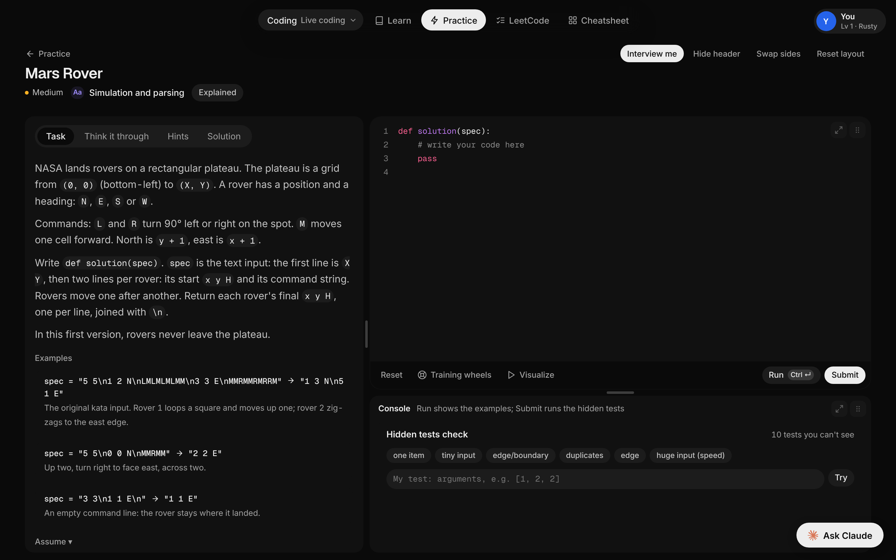
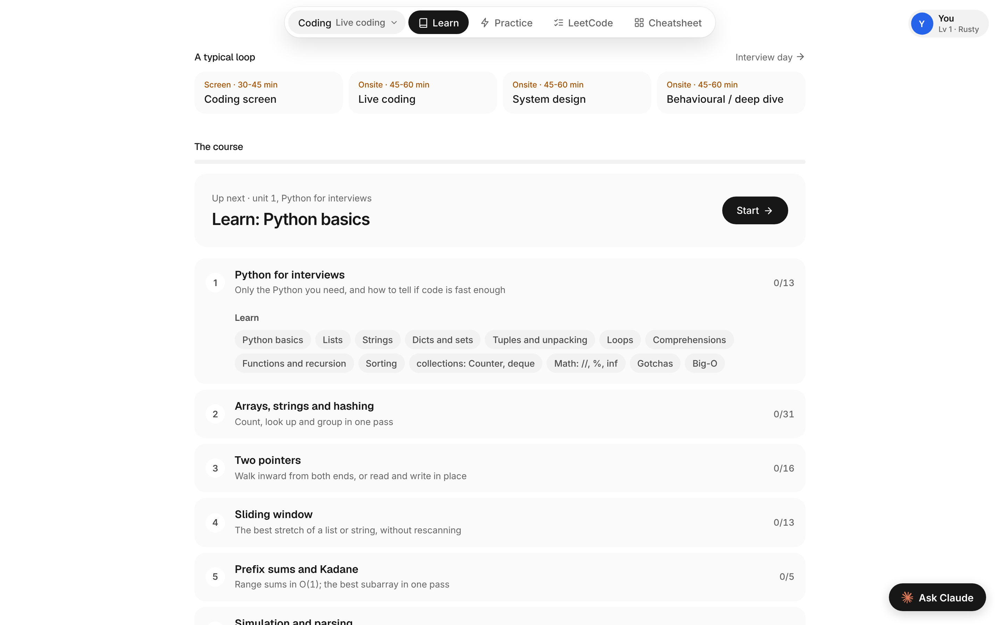
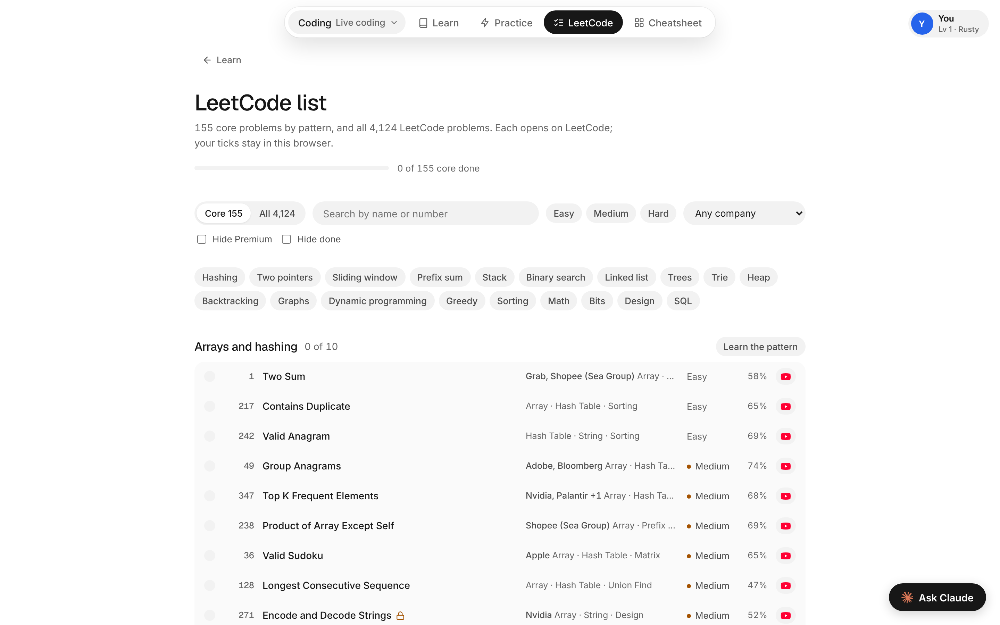
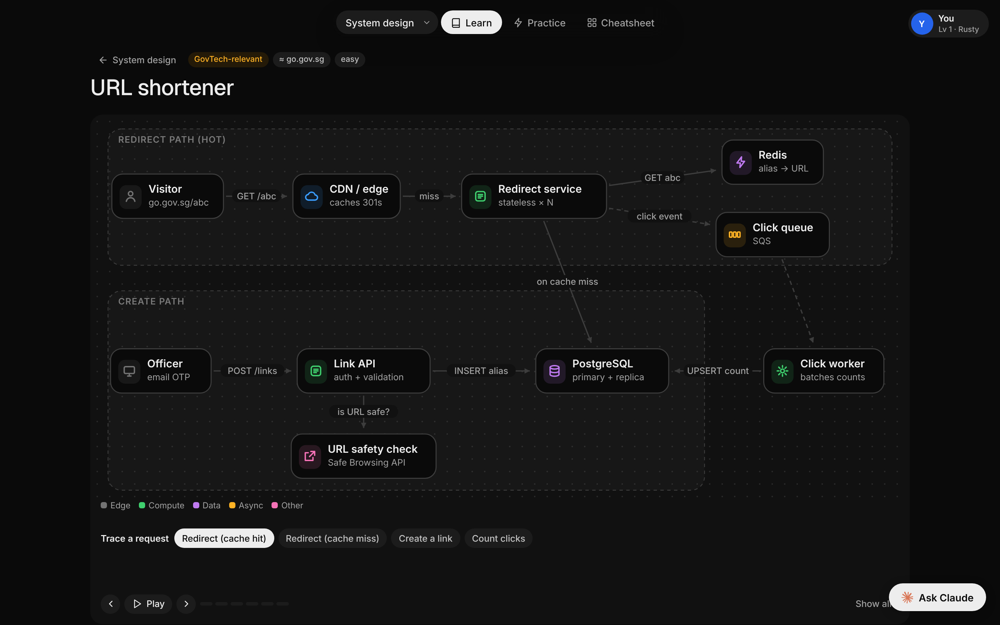
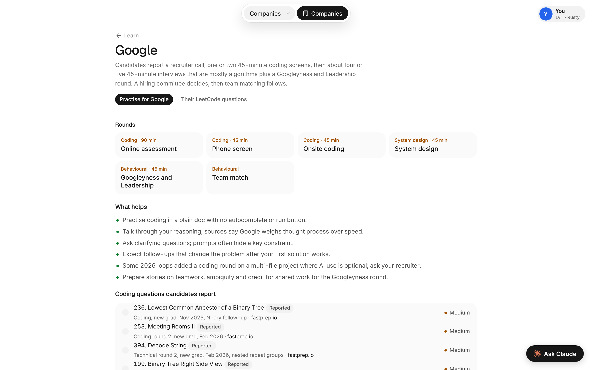
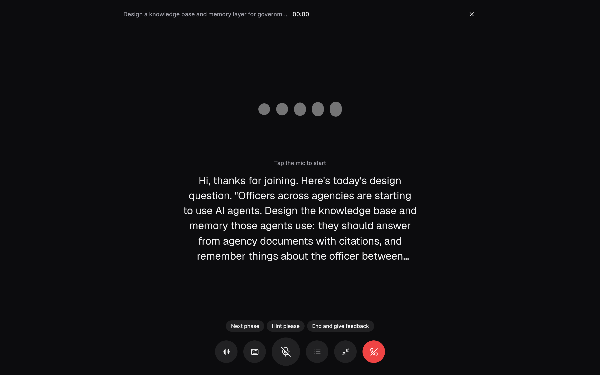
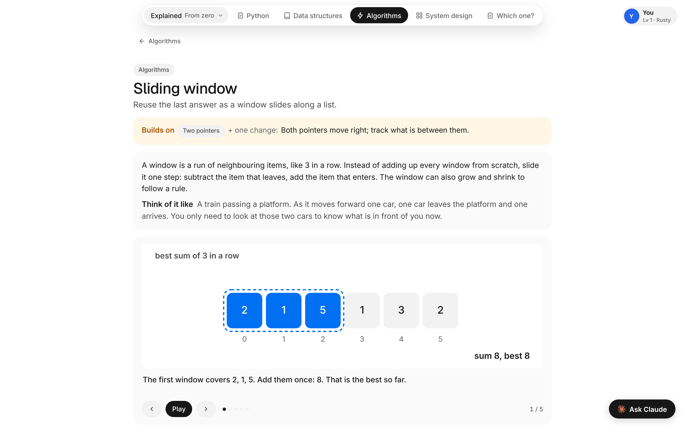
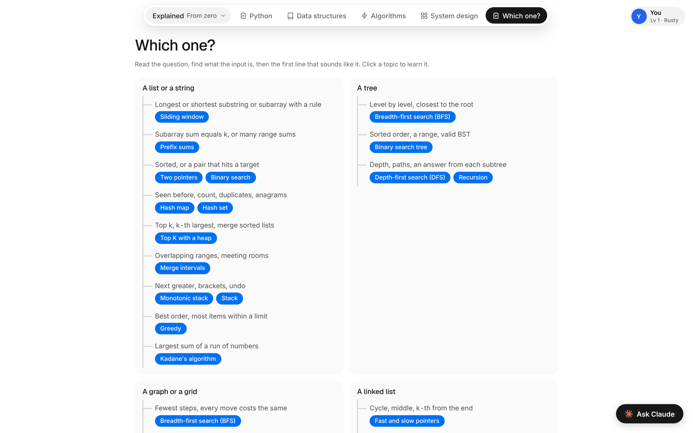
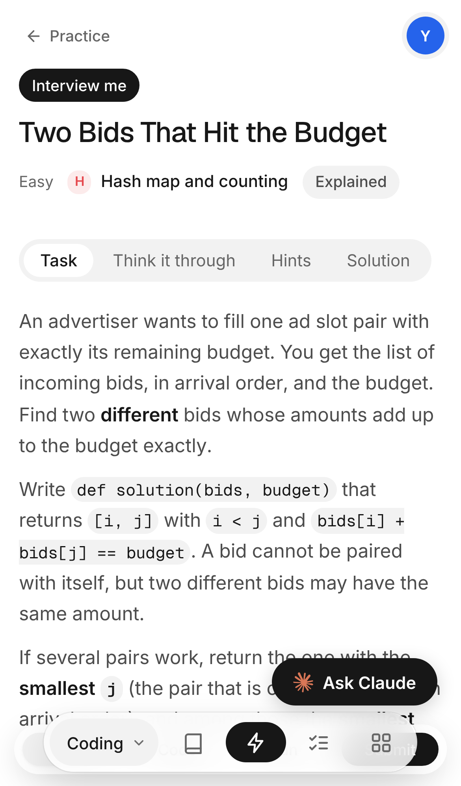
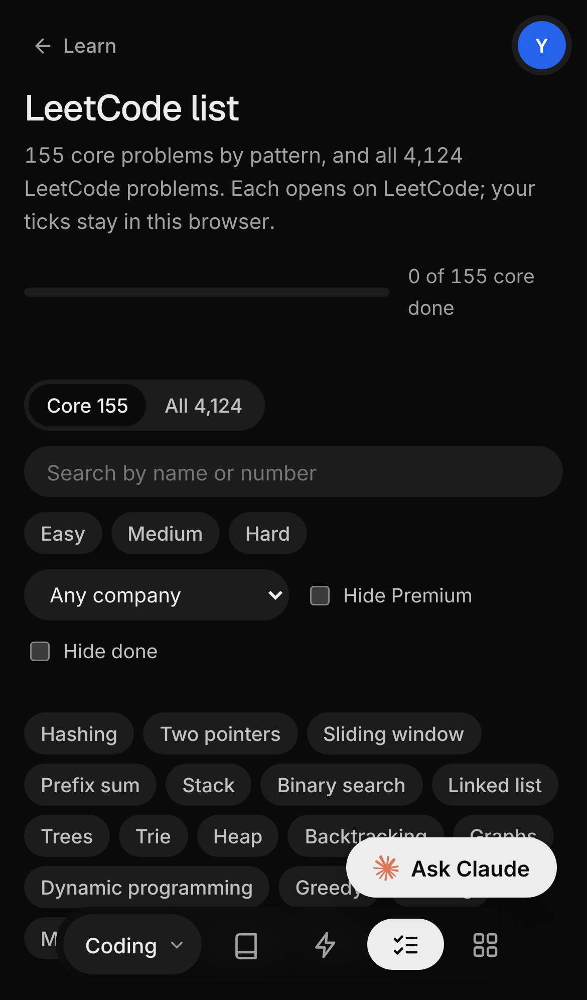

# Tech Interview Prep

Practise for software engineering interviews in one page: a course that takes every pattern from zero, problems in a real editor against hidden tests, all of LeetCode in one list, the questions candidates report at 38 companies, system design, and spoken mock interviews with Claude as the interviewer.

Everything is in Python. It is one self-contained HTML file: open it in a browser, host it anywhere, or use it as a claude.ai artifact with your own Claude.



## What's inside

| Part | What you get |
|---|---|
| Course | 18 units from Python basics to graphs and dynamic programming. Each unit has its lessons, problems here with hidden tests, and the LeetCode classics for it; "Up next" always points at the next thing to do |
| Coding | 93 problems with a task, hints, a step-by-step "think it through", a model solution, and hidden tests that run your Python in the browser, including a speed test on a big input |
| LeetCode list | All 4,124 LeetCode problems, searchable by name, number, difficulty, pattern and the company where candidates report them, plus a core list of 155 classics grouped into 18 patterns. Each opens on LeetCode, with a video search link |
| System design | 22 designs drawn as diagrams with animated request flows, 18 building blocks with small simulations, 19 timed rounds with model answers and a rubric, a 109-question drill, a whiteboard and a cheatsheet |
| Behavioural | A project worksheet, 60 deep-dive questions with what the interviewer is probing and what a strong answer covers, and a timed mock |
| Explained | 86 lessons from zero on Python, data structures, algorithms and system design, each with a step-through animation, a "Which one?" flowchart and side-by-side tables for the lookalikes |
| Companies | 38 company packs: rounds and timings, 820 questions candidates report (404 of them LeetCode problems), and 338 public sources, one cited on every question. Google, Meta, Amazon, Apple, Microsoft, Netflix, Airbnb, Uber, Stripe, Databricks, OpenAI, Jane Street, Grab, Shopee and more; adding a company is one JSON file |
| Mock interviews | Claude plays the interviewer out loud for a coding problem, a design question or your deep dive, listens to your answers, asks follow-ups, keeps time and scores you at the end |

| The course | LeetCode list |
|---|---|
|  |  |

### The course

The home page is a course in 18 units: Python for interviews; arrays, strings and hashing; two pointers; sliding window; prefix sums and Kadane; simulation and parsing; sorting and intervals; stacks and queues; binary search; linked lists; trees; heaps; tries; graphs; backtracking; dynamic programming; greedy, math and bits; and interview ready. Each unit lists its Explained lessons, the problems here that use the pattern, and its LeetCode classics. Progress comes from what you do anyway: lessons you open, problems you solve, LeetCode problems you tick.

### Companies

Each company pack lists the rounds candidates report and how long they take, what helps, and the questions they were asked, split into first-hand reports and prep-site lists. Every question links its source. Coding questions link to LeetCode or to the problem here; design prompts and practical tasks are listed by name. Pick a company and the mock interviewer plays its rounds; open its LeetCode questions to see them in the LeetCode list.

### Coding

Problems open in an IDE-style page: the task on the left, the editor on the right, the console below. Panels can be resized, swapped, maximised or hidden. **Run** checks the examples; **Submit** runs the hidden tests, grouped by what they check (one item, edge cases, duplicates, a big input for speed). Some problems add a visualiser that steps through your input, such as rovers moving on a grid or water filling between bars.

The **cheatsheet** puts every pattern on one page, with a flowchart from the words in a question to the pattern, a Big-O table for Python's built-ins, which data structure each pattern uses, and a step-through animation on every card. Grid, list, swipeable cards and a focus mode are all there.

### System design

| A design, dark mode | A company pack |
|---|---|
|  |  |

Each design starts from requirements and numbers, then the API, the data model, the diagram and one deep dive, and ends with follow-up questions. Timed rounds give you a prompt, clarifying answers on request, a whiteboard, and a model answer and rubric to compare against. With Claude available, **AI grade** reads your notes and whiteboard and scores them against the rubric.

### Mock interviews



Press **Interview me** on any problem or design question, or start the voice mock on the behavioural page. The interviewer works in phases like a real one: it asks you to restate and clarify, wants your approach and its Big-O before you code, stays quiet while you type, then asks for a walkthrough, edge cases and follow-ups. It reads your current code, your last test run, your whiteboard and your worksheet, and it knows how much time is left.

- **Talk or type.** Hands-free mode keeps the microphone open and sends your answer when you pause. Claude-voice mode speaks with a Claude voice; you tap the mic or press Space for each answer.
- **Full screen or a small card.** Coding interviews open as a card over the editor; design and behavioural interviews open full screen. Five bars show the interviewer listening, thinking and speaking, and a glow rises with your voice.
- **Feedback at the end.** Hang up to get spoken feedback and a written scorecard: a verdict, 1-5 on each area, and the one thing to fix first.
- **Pick a company** on the Companies page and the interviewer plays that company's round and timing. Without one, it runs a standard interview.

### Explained

| A lesson | Which one? |
|---|---|
|  |  |

For when you are rusty. Every lesson says what the thing is in plain words, gives a real-world picture, steps through one example, then shows the Python, how fast it is and the mistakes people make. Each lesson names the one it builds on and the single change between them. Problems link to the lesson for their pattern.

### On a phone

| A problem | LeetCode list, dark mode |
|---|---|
|  |  |

## Use it

### As a claude.ai artifact

Publish `app/dist/artifact.html` as an artifact with the `sample`, `tts`, `dictation` and `downloads` capabilities. Each viewer then uses their own Claude: the mock interviewer, AI grading and the chat panel run on their account, with Claude voices and dictation where claude.ai offers them (dictation needs Chrome or Edge on the web).

Progress syncs to each viewer's Claude account when they open the artifact signed in, so it follows them across devices (people with view-only access keep it in their browser).

### Self-hosted

Open `index.html` in a browser, or serve the folder:

```sh
python3 -m http.server 8000
```

GitHub Pages works too: set the Pages source to the default branch and the root folder.

Outside claude.ai the page brings its own versions of those capabilities:

- **Claude**: paste an [Anthropic API key](https://console.anthropic.com/settings/keys) when asked, or under Profile. It is kept in your browser's local storage and sent only to `api.anthropic.com`, through the official Anthropic SDK. Requests use `claude-opus-5-5` with server-side fallbacks enabled, so a declined request is retried on a fallback model. Usage is billed to your key.
- **Voice**: the browser's own speech recognition and speech synthesis (Chrome, Edge and Safari).
- **Python**: runs in the browser with Brython, loaded from a CDN, so the editor needs a connection the first time.

Self-hosted, your progress, ticks, notes and worksheet stay in your browser. Nothing is sent anywhere except the requests you make to Claude.

## How accurate is it?

- **Every problem is checked.** `tools/verify_problem.py` runs each reference solution against its tests in Python, and `tools/brython_check.js` runs them again in the browser and times the speed test.
- **Every page renders.** `tools/sweep.js` opens all 302 pages and fails on a script error, an empty page, or text such as `undefined` or `NaN`.
- **LeetCode is linked, not copied.** The list holds titles, links, difficulty, topics and acceptance rates from LeetCode's public problem list. Problem statements stay on LeetCode. The problems in this app are written for it.
- **Company packs come from public reports.** Every question cites the page it came from: a candidate's own account (Glassdoor, LeetCode Discuss, Blind, 1point3acres and pages that collect them) is marked "reported"; a prep site's list is marked "prep-site list" and is unverified. Round structure comes from the company's own careers pages where they publish one. Where a report only said a question was similar to a LeetCode problem, its note says so. Interview processes change and differ by team: treat a pack as a likely shape, not an official agenda. `tools/check_packs.py` checks every pack's format, links and LeetCode slugs.
- **System design numbers are rough on purpose.** Latencies, sizes and costs are orders of magnitude for estimating in an interview, not benchmarks of any product.

## Build it yourself

You need Python 3 to build, and Node.js with Playwright to run the checks.

```sh
cd app && python3 build.py   # writes ../index.html and dist/artifact.html
node tools/sweep.js          # from the repository root: opens every page
node tools/screenshots.js    # regenerates docs/screenshots
```

```
index.html              the built app, ready to open or host
app/build.py            assembles the app from the files below
app/orig.html           the base app: shell, styles, problem runner, editor, progress
app/*.js                modules: system design (sd.js), cheatsheets (sheet.js, cheats.js, flow.js),
                        problem editor (ide.js), mock interviewer (interview.js), behavioural (dd.js), ...
app/content/            problems, designs, building blocks and the question banks, one JSON file each
app/public/             LeetCode list, company packs, self-hosted Claude and voice, and the build patch
app/public/packs/       one JSON file per company
app/vendor/             Voice Glow, bundled
ex/                     Explained: the lessons (topics/), their renderer and the "Which one?" flowchart
tools/                  checks, screenshots, and the LeetCode list fetcher
docs/screenshots/       images used in this README
```

To refresh the LeetCode list, run `python3 app/public/fetch_leetcode.py` to download the public problem list, save it as `app/public/leetcode-raw.json`, then run `python3 app/public/leetcode_build.py` and rebuild.

## Add a company

Add `app/public/packs/<id>.json` and rebuild:

```json
{
  "id": "acme",
  "name": "Acme",
  "role": "Backend software engineer",
  "summary": "One or two sentences on what candidates report.",
  "rounds": [
    { "name": "Phone screen", "minutes": 45, "kind": "coding", "what": "Two LeetCode-style problems, easy to medium.", "practice": "leetcode" },
    { "name": "System design", "minutes": 60, "kind": "design", "what": "A product-shaped design.", "practice": "sd-practice" },
    { "name": "Behavioural", "minutes": 45, "kind": "behavioural", "what": "Projects you owned.", "practice": "dd-mock" }
  ],
  "tips": ["What candidates say helps."],
  "reported": [{ "problem": "two-sum", "tag": "reported", "note": "Phone screen, 2026" }],
  "sources": [{ "label": "Where this came from", "url": "https://example.com/report" }],
  "caveat": "Built from public candidate reports."
}
```

Questions can also be `{"lc": "<leetcode-slug>", ...}` for a LeetCode problem or `{"title": "...", ...}` for anything else, and each one names its `source` (one of the pack's source URLs). Run `python3 tools/check_packs.py` before you open a pull request.

`kind` is `coding`, `design` or `behavioural`; the mock interviewer uses the matching round's name, length and description. `problem` is the id of a problem in `app/content/problems/` (the file name without `.json`). `tag` is `reported` for a candidate's own report, or `listed` for a prep site's list. Only add what a public source supports, and link it.

## License

The code and the written content are released under the [MIT License](LICENSE). Bundled and linked third-party code keeps its own license: see [THIRD_PARTY.md](THIRD_PARTY.md). LeetCode is a trademark of its owner; this project is not affiliated with LeetCode, GovTech, AppLovin, Anthropic or any company it mentions. Linked videos belong to their creators.
